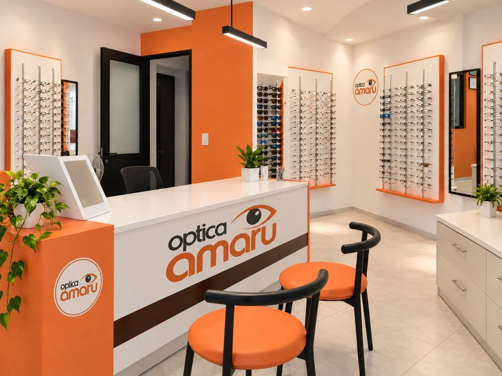

## 📌 Descripción del proyecto

Óptica Amaru es un sistema web desarrollado para facilitar la gestión y atención de clientes de una óptica. Permite consultar productos, realizar solicitudes y gestionar citas mediante una plataforma web.

El proyecto está desarrollado utilizando Python y Django, con una base de datos MySQL y posibilidad de conexión a una base de datos alojada en Aiven.

## 🚀 Tecnologías utilizadas

| Tecnología | Uso |
|---|---|
| Python | Lenguaje principal del proyecto. |
| Django | Framework para el desarrollo web. |
| MySQL | Sistema de gestión de base de datos. |
| Aiven | Servicio de base de datos en la nube. |
| HTML5 | Estructura de las páginas. |
| CSS3 | Diseño y estilos de la plataforma. |
| JavaScript | Funcionalidades e interacciones. |
| Git | Control de versiones. |
| GitHub | Almacenamiento y colaboración del código. |

## 🖥️ Funcionalidades del sistema

### Catálogo de productos
Consulta de los productos y lentes disponibles en la óptica.

### Solicitudes de productos
Permite realizar solicitudes de productos mediante los formularios del sistema.

### Consulta de solicitudes
Permite consultar el estado de una solicitud y revisar sus detalles.

### Gestión de citas
Módulo para solicitar horas de atención mediante un formulario de agendamiento.

### Gestión de información
Administración de los datos del sistema mediante Django y su conexión con MySQL.

## 📂 Estructura del proyecto

```text
OpticaAmaru/
│
├── OpticaAmaru/
│   ├── settings.py
│   ├── urls.py
│   ├── asgi.py
│   └── wsgi.py
│
├── opticaApp/
│   ├── migrations/
│   ├── admin.py
│   ├── apps.py
│   ├── forms.py
│   ├── models.py
│   ├── tests.py
│   └── views.py
│
├── templates/
│   ├── base.html
│   ├── inicio.html
│   ├── catalogo.html
│   ├── solicitar.html
│   ├── solicitud_creada.html
│   ├── consultar_estado.html
│   ├── detalle_solicitud.html
│   ├── lista_solicitudes.html
│   ├── pedir_hora.html
│   └── cita_creada.html
│
├── static/
│   ├── css/
│   │   └── amaru.css
│   ├── img/
│   │   ├── logo.png
│   │   └── tienda.jpg
│   └── documentos/
│
├── media/
│   ├── lentes/
│   └── recetas/
│
├── base.sql
├── baseAiven.sql
├── manage.py
├── requirements.txt
└── README.md
```

## ⚙️ Instalación y configuración

### 1. Requisitos previos

Antes de ejecutar el proyecto, necesitas tener instalado:

- Python.
- MySQL Server o XAMPP.
- Git.
- Visual Studio Code (recomendado).

### 2. Clonar el repositorio

Abre PowerShell y ejecuta:

```powershell
git clone URL_DEL_REPOSITORIO
```

Ingresa a la carpeta:

```powershell
cd Optica-amaru-main
```

### 3. Crear un entorno virtual

```powershell
python -m venv venv
```

Activar el entorno virtual:

```powershell
.\venv\Scripts\activate
```

### 4. Instalar las dependencias

```powershell
pip install -r requirements.txt
```

Si necesitas trabajar con imágenes y Pillow no está incluido en las dependencias:

```powershell
pip install Pillow
```

### 5. Configurar la base de datos

El proyecto contempla dos alternativas de conexión:

- **MySQL local:** utilizando XAMPP.
- **Aiven:** utilizando una instancia MySQL alojada en la nube.

Para utilizar MySQL local:

1. Inicia MySQL desde XAMPP.
2. Abre phpMyAdmin.
3. Crea la base de datos `optica_amaru_bd`.
4. Configura la conexión en `OpticaAmaru/settings.py`.

Si utilizas Aiven, configura los datos de conexión y el certificado SSL correspondiente.

**Importante:** No publiques contraseñas, archivos `.env`, certificados privados ni credenciales de conexión en GitHub.

### 6. Ejecutar las migraciones

Desde la carpeta donde se encuentra `manage.py`, ejecuta:

```powershell
python manage.py migrate
```

### 7. Iniciar el servidor

```powershell
python manage.py runserver
```

Luego abre en tu navegador:

```text
http://127.0.0.1:8000/
```

## 🌿 Trabajo colaborativo con Git

Para mantener el proyecto organizado, el equipo trabaja utilizando ramas independientes.

La rama `main` corresponde a la versión principal del proyecto. Cada integrante debe trabajar en su propia rama y solicitar la integración de sus cambios mediante un Pull Request.

### Flujo de trabajo

```text
        MAIN
          |
    Crear una rama
          |
    Trabajar en ella
          |
       Commit
          |
        Push
          |
    Pull Request
          |
       Revisión
          |
        Merge
          |
        MAIN
```

### Comandos principales

**Actualizar el proyecto:**

```powershell
git pull origin main
```

**Crear una rama:**

```powershell
git checkout -b nombre-de-tu-rama
```

**Revisar los cambios:**

```powershell
git status
```

**Agregar archivos específicos:**

```powershell
git add archivo1 archivo2
```

**Crear un commit:**

```powershell
git commit -m "Descripción de los cambios"
```

**Subir la rama:**

```powershell
git push -u origin nombre-de-tu-rama
```

**Cambiar de rama:**

```powershell
git checkout main
```

**Consultar las ramas disponibles:**

```powershell
git branch
```

### Reglas de colaboración

1. Actualizar el proyecto antes de comenzar a trabajar.
2. No modificar directamente `main`.
3. Cada integrante debe utilizar su propia rama.
4. Avisar antes de modificar archivos compartidos como `models.py`, `urls.py`, `settings.py` y `base.html`.
5. Las migraciones deben coordinarse entre los integrantes.
6. Revisar los cambios antes de realizar un commit.
7. Integrar los cambios a `main` mediante Pull Request.

## 🔐 Seguridad del proyecto

Para evitar la exposición de información sensible:

- No subir archivos `.env`.
- No publicar contraseñas de bases de datos.
- No subir claves privadas ni credenciales.
- Revisar los archivos antes de realizar un `git push`.
- Mantener las configuraciones sensibles fuera del repositorio público.

## 📸 Capturas del sistema

En esta sección se pueden agregar imágenes de las distintas funcionalidades de Óptica Amaru.

Ejemplo:

```markdown
### Página principal



### Catálogo de productos


### Solicitud de hora


```

---

<p align="center">
  **Óptica Amaru**
  
  Sistema web desarrollado como proyecto colaborativo.
</p>
